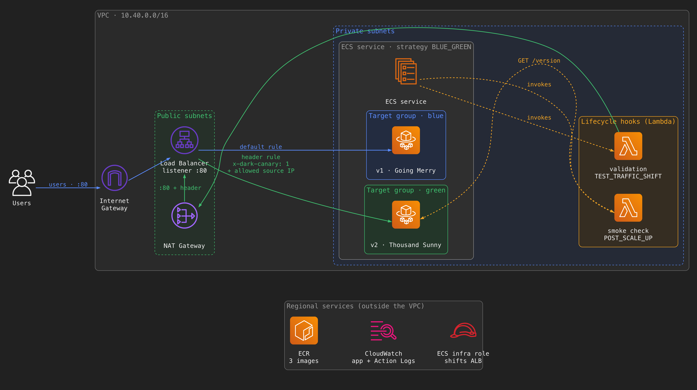

# Dark Canary on Amazon ECS

Demo for the talk **"Zero Users Exposed, Full Production Validation: Dark Canary on ECS"** (AWS Community Day South Florida, October 14, 2026).

A new version of the app runs in the real production infrastructure, but only **test traffic** reaches it. A Lambda lifecycle hook validates it. If the hook fails, ECS rolls back. If it passes, the deployment pauses until you approve the switch for real users.



## What it shows

- **Native ECS blue/green** (no CodeDeploy): `strategy = "BLUE_GREEN"`, two target groups, bake time.
- **Test traffic on the same ALB**: a listener rule on `:80` that matches the header `x-dark-canary: 1` **and** an allowed source IP (yours and the NAT gateway's). Everyone else gets the production rule. A separate `:8080` test listener is also supported (`scripts/set-routing.sh port`).
- **Lifecycle hooks**:
  - `POST_SCALE_UP`: smoke check that calls each green task directly.
  - `TEST_TRAFFIC_SHIFT`: validation that sends test traffic in rounds (`IN_PROGRESS` + `callBackDelay`) and fails the deployment on errors.
  - `POST_TEST_TRAFFIC_SHIFT`: a **PAUSE** hook, resumed with `ContinueServiceDeployment`.
- **Deployment circuit breaker** with a configurable threshold, and **ECS Action Logs** delivered to CloudWatch Logs.

The app is a One Piece bounty board. `v1` (Going Merry, blue) is stable. `v2-broken` (Thousand Sunny, green) never releases a pooled resource, so it fails after 20 requests. `v2-fixed` is the same release with the fix.

## Requirements

- An AWS account and a CLI profile with permissions to create the resources in `infra/`
- Terraform >= 1.9
- Node.js 24 and pnpm (`corepack enable`), Docker with `buildx` (images are built for `arm64`)
- AWS CLI v2, `jq`

## Run it

```bash
cp infra/terraform.tfvars.example infra/terraform.tfvars
# set presenter_cidr to your public IP: curl -s https://checkip.amazonaws.com

export AWS_PROFILE=<your-profile> AWS_REGION=us-west-2

scripts/bootstrap.sh          # ECR, images (v1, v2-broken, v2-fixed), the whole stack
scripts/deploy.sh v2-broken   # act 1: validation fails, ECS rolls back
scripts/status.sh             # deployment status, stage and hooks
scripts/deploy.sh v2-fixed    # act 2: validation passes, the deployment pauses
scripts/continue.sh           # approve: production traffic moves to green
scripts/destroy.sh            # tear everything down
```

To see green in a browser, send the header with an extension such as ModHeader (`x-dark-canary: 1`), or start the local proxy, which adds the header for you and prints a command to open a separate Chrome window on the real ALB URL:

```bash
node scripts/test-proxy.mjs
```

Or use curl:

```bash
curl "$(terraform -chdir=infra output -raw prod_url)/version"
curl -H "x-dark-canary: 1" "$(terraform -chdir=infra output -raw prod_url)/version"
```

## Cost

Roughly $0.10 per hour while it runs in us-west-2 (mostly the NAT gateway and the ALB). Run `scripts/destroy.sh` when you finish.

## Intentional choices

This is a demo you create and destroy, not a production template.

- **One environment, local state.** In a real setup, use one state per environment (for example an S3 backend with locking) and reuse this configuration as a module.
- **Deploys go through `scripts/deploy.sh`, not `terraform apply`.** That's why the service ignores changes to `task_definition`, and the listener rules ignore changes to `action`: ECS rewrites the target group weights on every deployment.
- **The circuit breaker threshold is set with the AWS SDK** (`scripts/ecs.mjs circuit-breaker`), because the Terraform AWS provider (6.66) doesn't support `thresholdConfiguration` yet.
- **HTTP only.** In production, add a `:443` listener with an ACM certificate and redirect `:80`. The listener rules stay the same.
- **The header is not a secret.** The source IP condition is what keeps other people out of green.
- **`force_delete` / `force_destroy`** on ECR and the log bucket, so `destroy` leaves nothing behind.
- **Test traffic only reads.** Green uses the same data as production. If your checks write, use test accounts that live in production and filter them out.

## Repository layout

```
infra/    Terraform: VPC, ALB, ECS service, hooks, IAM, logs
app/      The bounty board (src/v1, src/v2-broken, src/v2-fixed)
hooks/    Lambda lifecycle hooks (TypeScript, bundled with esbuild)
scripts/  bootstrap, deploy, status, continue, set-routing, destroy
```

## License

Code: [MIT](LICENSE). The character images in `app/public/crew/` are not covered by the license; see [CREDITS.md](CREDITS.md).
